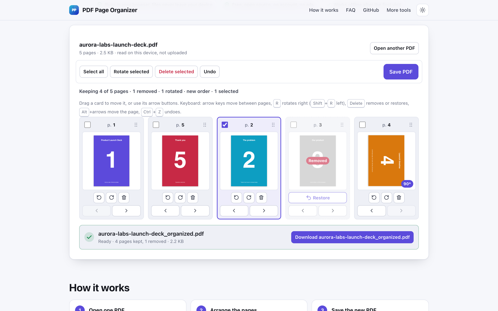
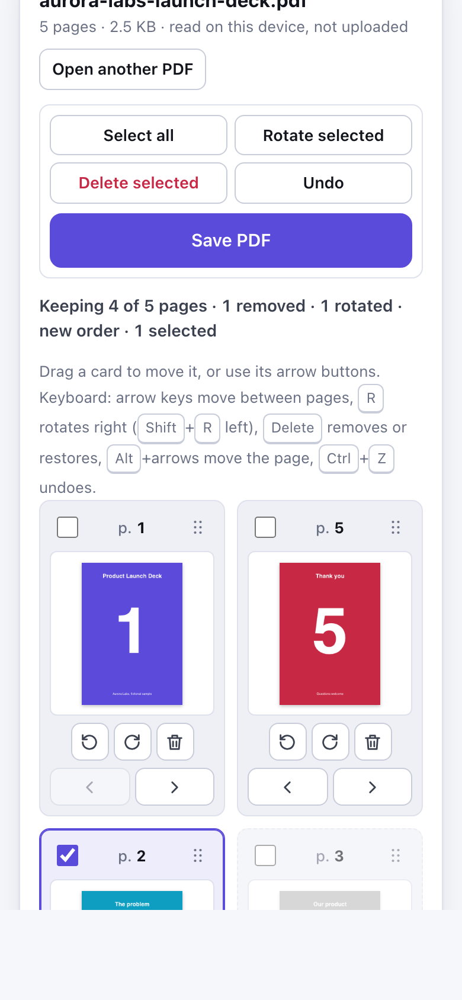

# PDF Page Organizer

> Reorder, rotate and delete PDF pages visually in your browser and save the result, with no upload.

**🌐 Use it now: [turhe123.github.io/pdf-page-organizer](https://turhe123.github.io/pdf-page-organizer/)** · free · open source · runs in your browser · works offline


## Why

PDF Page Organizer is a free, open-source alternative to Sejda and iLovePDF Organize PDF, whose free tiers limit pages and tasks per hour, upload your documents, and show ads and upsells. Here your files never leave your device, there is no account, no ads and no limits, it works offline, and you can install it as an app.

## Screenshots

<p align="center"></p>

<p align="center"><em>PDF Page Organizer in the browser, light theme</em></p>

<p align="center"></p>

<p align="center"><em>PDF Page Organizer on a phone</em></p>

## Features

- Shows every page of a PDF as a thumbnail card with a page number badge.
- Thumbnails are drawn lazily with pdf.js as cards scroll into view, at about 160 px, and are released when far off screen, so a 200 page file stays responsive.
- Pages that carry their own rotation display correctly in the thumbnails.
- Rotate a page left or right in 90 degree steps. The saved rotation is the page's original rotation plus your rotation, modulo 360.
- Delete pages. Deleted pages stay in the grid, dimmed, with a Restore button until you save.
- Reorder by dragging a card (mouse or pen; on touch, drag by the grip handle), with move earlier / move later buttons that are always visible for touch and keyboard.
- Select pages with checkboxes, then use Select all, Rotate selected or Delete selected.
- Undo steps back through your changes (up to 300 actions), also with Ctrl/Cmd+Z.
- Keyboard: arrow keys move between cards, Home/End jump to the first/last card, `R` rotates right (`Shift`+`R` left), `Delete` removes or restores, `Alt`+arrows (or Home/End) move the page, Space/Enter toggle selection.
- A live summary shows pages kept, removed, rotated, and whether the order changed.
- Save PDF builds a new file named `yourfile_organized.pdf` with pdf-lib in a Web Worker, shows progress, and downloads it. The original file is not modified.
- Clear, visible error messages for unreadable files, non-PDF files, password protected files, and for trying to save with every page deleted.
- Light and dark themes, responsive layout (two column thumbnail grid on phones), installable PWA.

**Input:** one PDF file at a time (`.pdf`, by drop or file picker).
**Output:** one PDF with the pages you kept, in your order.
**Limits:** no built-in page or size limit; large files are limited only by your device's memory. Password protected or encrypted PDFs are not supported. It does not edit page content, add text or merge files.

## How to use

1. Drop a PDF onto the page, or choose one. A thumbnail appears for each page.
2. Drag cards, or use the arrow buttons, to put the pages in the order you want.
3. Rotate pages with the rotate buttons and delete the ones you do not need. Use Undo if you change your mind.
4. Press Save PDF to download the new file.

## Privacy

- Nothing is uploaded. Your PDF is read, previewed and rewritten entirely in your browser.
- No cookies.
- Page views are counted anonymously with [GoatCounter](https://www.goatcounter.com/) (cookieless, open source). That is the only network request the page makes besides loading its own files.
- After the first visit a service worker caches the app, so it works offline.

## Run it locally

```sh
git clone https://github.com/turhe123/pdf-page-organizer
cd pdf-page-organizer
python3 -m http.server 4173
```

Then open http://127.0.0.1:4173/ (no build step).

## Tests

```sh
npm i -D @playwright/test && npx playwright install chromium
npx playwright test
```

## Third-party code

Bundled in `vendor/`, each with its license:

| Library | Version | License |
| --- | --- | --- |
| [pdf-lib](https://github.com/Hopding/pdf-lib) | 1.17.1 | MIT |
| [pdfjs-dist](https://github.com/mozilla/pdf.js) | 4.10.38 | Apache-2.0 |

## Built with AI

PDF Page Organizer was written by [Claude Code](https://claude.com/claude-code) inside an automated pipeline, from a plain-English spec. No code or assets from any commercial product were used; it is a clean-room implementation of a feature set, not a copy.

What that means in practice:

- The full source is in this repo under the MIT license. Read it before you trust it with your files.
- Everything runs in your browser. It makes no network requests except an anonymous, cookieless page-view count (GoatCounter); your files never leave the device.
- The page is tested headless in Chromium (Playwright) before every release, but it has had less human review than hand-written software. Bug reports and pull requests are welcome.

## Support ❤️

If this saved you a subscription, you can say thanks on [Ko-fi](https://ko-fi.com/leodavidai).

## More free web tools

Find more at [turhe123.github.io/web-tools](https://turhe123.github.io/web-tools/).

## License

MIT © Or Davidai Bachar
